<div align="center">

<p align="center">
  
</p>

<p align="center">
  
</p>

<p align="center">
  <a href="#overview"></a>
  <a href="#quick-start"></a>
  <a href="#how-it-works"></a>
  <br />
  <a href="#lite-mode-for-low-end-devices"></a>
  <a href="#what-changed"></a>
  <a href="#troubleshooting"></a>
</p>

</div>


## Overview

People can feel the moment an argument stops engaging with the point, but finding that moment in an hour of speech takes time. RhetoricLens listens, checks each finished sentence against six fallacy patterns, and turns the result into concise, timestamped cues you can inspect in context, with a separate **Rhetorical Rigor Score** for every speaker.

| 🎙️ Listen | 🔎 Examine | 📍 Understand |
|:--|:--|:--|
| Live microphone, an uploaded audio or video file, or typed text. English and Hindi. | Each finished sentence is checked with the last 30 seconds of conversation as context. | The exact phrase, a short explanation, a timestamp, the point change and a Rigor Score per speaker. |

**The six fallacies it looks for:** `Ad Hominem` · `Straw Man` · `False Dilemma` · `Circular Reasoning` · `Slippery Slope` · `Red Herring`

> [!NOTE]
> A flag is a cue for inspection, not a verdict about truth or who is right. Detection is imperfect, only six fallacy types are covered, and the penalty weights are configurable but not scientifically validated.

### Two pages, one design language

| Page | Route | What it is |
|:--|:--|:--|
| **Cover site** | `/` | Cinematic, scroll-reactive landing page: hero, how it works, a live-preview card, use cases and principles. |
| **Analyzer** | `/app` | The working console, opened by **Launch Analyzer**. |

Both pages share the same tokens: a near-black ground, mint signal colour, violet and pink accents, **Manrope** headings, **DM Sans** body text, **DM Mono** labels, film grain and the tinted pulse-ring emblem. Flags are pink, live and healthy states are mint, warnings are amber. Going from the site into the analyzer feels like one product.

<details>
<summary><b>Analyzer features</b></summary>

<br />

- **Live speech stage** with the current sentence and the flagged phrase highlighted in pink.
- **Rigor Score gauges** for Speaker A and Speaker B that change colour as the score drops.
- **Live flag card** with fallacy type, quoted phrase, explanation and penalty.
- **Evidence trail** (transcript history) and a **flag timeline** of every move under review.
- **Input:** microphone, audio or video upload (up to 100 MB), or a typed sentence.
- **Language:** English or Hindi.
- **Scripted scenarios** for rehearsal without API keys: **Play demo** (a short two-speaker debate), Clean argument, Ad hominem, False dilemma and Straw man.

</details>


## Quick start

**Windows, one click:** double-click `start.bat`. It creates a virtual environment, installs the requirements, starts the server and opens the browser.

**Manual:**

```bash
python -m venv .venv
```

```bat
.venv\Scripts\activate
pip install -r requirements.txt
copy .env.example .env
uvicorn app.main:app --reload
```

Then open **http://127.0.0.1:8000** for the cover site, or **http://127.0.0.1:8000/app** for the analyzer.

The scripted demo works out of the box with `LLM_PROVIDER=mock`, with no keys needed. For live classification set `LLM_PROVIDER=groq` and `GROQ_API_KEY`. Live microphone transcription needs `DEEPGRAM_API_KEY`.

<details>
<summary><b>Configuration reference (.env)</b></summary>

<br />

Copy `.env.example` to `.env`. Never commit `.env`.

| Variable | Default | Purpose |
|:--|:--|:--|
| `LLM_PROVIDER` | `mock` | `mock` for scripted rehearsal with no key, `groq` for the real classifier. |
| `GROQ_API_KEY` | | Required when `LLM_PROVIDER=groq`. |
| `GROQ_MODEL` | `openai/gpt-oss-20b` | Classifier model. |
| `GROQ_TIMEOUT_SECONDS` | `6` | Classifier timeout. |
| `DEEPGRAM_API_KEY` | | Required for live microphone and uploaded-file transcription. |
| `DEEPGRAM_MODEL` | `nova-3` | Speech-to-text model. |
| `DEEPGRAM_LANGUAGE` | `en-US` | Default speech language. |
| `CONFIDENCE_THRESHOLD` | `0.75` | Minimum classifier confidence for a flag. |
| `WINDOW_SECONDS` | `30` | Rolling conversation context. |

</details>


## How it works



<br />

**The classifier only proposes a finding. The server decides whether it appears.** It checks the confidence threshold, that the quoted phrase really occurs in the sentence, quote and explanation length, and duplicates. The server then calculates the score. Scripted demo lines go through the same validation and scoring using the deterministic provider, so the demo shows its example flags even when live AI mode is configured.

<details>
<summary><b>Architecture details</b></summary>

<br />

- Python and **FastAPI** serve a plain HTML, CSS and JavaScript interface.
- Live microphone audio goes over **WebSockets** to **Deepgram** streaming speech-to-text.
- Uploaded audio or video is transcribed with speaker labels.
- A rolling 30-second conversation buffer gives the structured **Groq** classifier its context.
- Endpoints used by the front end: `/ws` (state, detections and audio), `/api/config` (provider mode) and `/api/transcribe` (file upload).
- The app needs a **persistent server** for the WebSocket endpoint. Serverless hosts without WebSocket support will not run the live analyzer.

</details>


## Lite mode for low-end devices

RhetoricLens detects weak devices and automatically drops the expensive effects. The layout, content and behaviour stay the same, and nothing in the analysis logic changes.



<br />

| Full design | Lite mode |
|:--|:--|
| Four-layer 3D emblem with blend modes and glow | One flat emblem layer |
| Animated hero trace and rings | Finished static trace |
| Film-grain overlay and looping decorative animations | Removed |
| Entrance and row animations | Removed |
| All landing sections rendered up front | Off-screen sections render when scrolled to |

**It turns on automatically** when `perf.js` sees 4 GB of RAM or less, 2 CPU threads or fewer, Data Saver, a 2G or 3G connection, or a measured frame rate under about 30 fps (a one-time check after load, for browsers that do not report device specs).

**Manual override**, remembered by the browser:

| Add to the URL | Effect |
|:--|:--|
| `?lite=1` | Force lite mode |
| `?lite=0` | Force the full design |
| `?lite=auto` | Clear the override |

> [!TIP]
> Before a live demo, force the mode you want with `?lite=1` or `?lite=0` so nothing is left to automatic detection.

Fonts load without blocking the page and only the weights in use are requested. Both pages also ask the browser for a smooth cross-page fade, and browsers without support simply navigate normally.


## Project structure

```text
static/
├── landing.html · landing.css · landing.js   Cover site and its scroll-reactive emblem
├── index.html   · style.css   · app.js       Analyzer console
├── perf.js                                   Adaptive lite-mode detection
├── rhetoriclens-mark.png · favicon.png       Logo and emblem
app/
└── main.py                                   FastAPI server, WebSocket, scoring
docs/                                         README graphics (animated SVG)
requirements.txt · .env.example · start.bat
```

> The front-end layout above is where the files belong. Adjust it if your project keeps the HTML files in a different folder.


## What changed

<details open>
<summary><b>Design sync</b></summary>

<br />

- The analyzer now shares the cover site's tokens, fonts, grain, emblem, buttons and panel styling.
- The analyzer has the site navigation and a **Back to site** link, and a footer matching the cover site.
- Flag colours are unified: pink for flags, mint for live and healthy, amber for warnings, rose for critical.
- The analyzer headline highlights **structure** in mint, echoing the cover site's two-tone headings.
- The score is called **Rigor score** in the console, matching the rest of the project.
- Panels fade up on load like the cover sections.
- The cover site's nav button now reads **Launch Analyzer**.
- Fixed the analyzer's horizontal overflow on phones, where score cards now stack.
- `app.js`: colour references only, plus removal of dead browser-speech state. No logic changes.

</details>

<details open>
<summary><b>Performance</b></summary>

<br />

- New `perf.js`, plus `html[data-perf="lite"]` styles in `landing.css` and `style.css`.
- `landing.js` stops its continuous animation loop in lite mode and updates the emblem on scroll only.
- Google Fonts moved from a render-blocking `@import` to non-blocking `<link>` tags, with unused weights removed.
- Emblem images decode asynchronously.

</details>

<details>
<summary><b>Cache versions</b></summary>

<br />

Bump the matching `?v=` in the HTML whenever you change a file, or browsers may serve an old copy during a demo.

| File | Version |
|:--|:--|
| `style.css` | `?v=10` |
| `app.js` | `?v=9` |
| `landing.css` | `?v=6` |
| `landing.js` | `?v=5` |
| `perf.js` | `?v=1` |

</details>


## Troubleshooting

<details>
<summary><b>Common problems</b></summary>

<br />

| Problem | Fix |
|:--|:--|
| Page looks unchanged after an update | Hard-refresh with `Ctrl+Shift+R` and check the cache versions above. |
| Microphone does nothing | Add `DEEPGRAM_API_KEY` to `.env` and allow microphone access in the browser. |
| "Scripted demo mode" badge shows | `LLM_PROVIDER=mock`. Set it to `groq` and add `GROQ_API_KEY` for live analysis. |
| Status shows **Disconnected** | The server is not running, or the host blocks WebSockets. |
| Page feels heavy on an old device | Add `?lite=1` to the URL and check that `perf.js` is loading. |

</details>

## Responsible use

RhetoricLens points to words worth a second look. It does not judge truth, intent or who is right, and it should not be used to score or penalise people on its own. Read each flag in context.

<div align="center">


<sub>**HEAR THE WORDS. SEE THE STRUCTURE.** · JAI 2026 Hackathon · JIIT Noida</sub>

</div>
